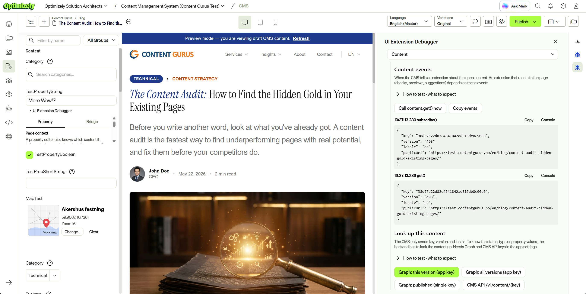
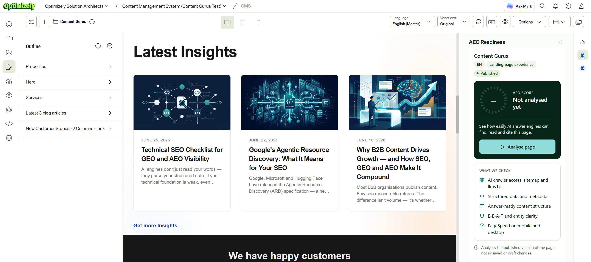
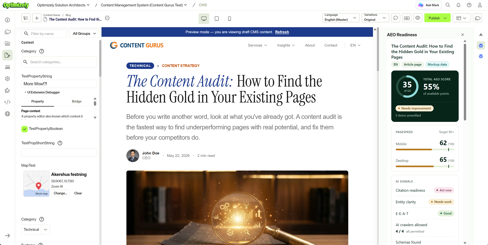
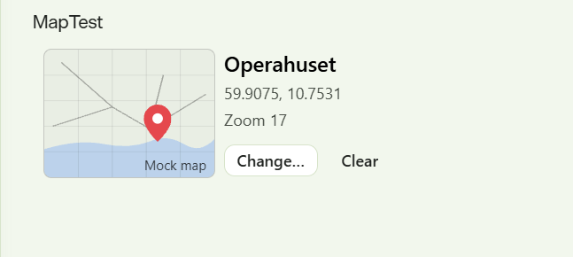
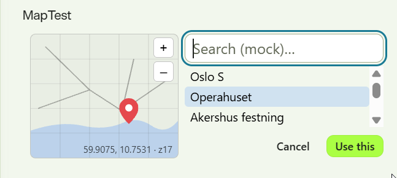

# SaaS CMS UI Extension Debugger

**See exactly what an Optimizely SaaS CMS UI extension can see and do, from inside the CMS.**

This is an [Optimizely Connect Platform (OCP)](https://docs.developers.optimizely.com/optimizely-connect-platform/)
app that puts a debugger in every place a CMS UI extension can live: the editor sidebar, a
full-page view and property editors. It logs the messages between the extension and the CMS,
calls its own backend, queries the CMS REST API and Optimizely Graph, and tests what the
browser sandbox allows. Every section explains what it tests and what to expect.

If you're planning to build a CMS UI extension, install this first. You'll find out in an
afternoon what your extension will get from the CMS, what it has to fetch itself, and where the
limits are.

The repo also has two mockups that show what real extensions can look like: an **AEO
Readiness** sidebar and a **Map Reference** property editor.



*The debugger in the sidebar (right), showing the content events the CMS sends. On the left,
two property editors from this app: the debug string editor (a working text field with the
debugger folded underneath) and the map reference editor.*

## What's in the app

| Extension | Where it appears | What it is |
| --- | --- | --- |
| UI Extension Debugger | Sidebar | The full debugger, following the content open in the editor |
| UI Extension Debugger | View (full page) | The full debugger, as a standalone page |
| Debug String Editor | Property editor, long string | A working text editor, with the debugger folded below |
| Debug Short String Editor | Property editor, short string | The same, for short strings |
| Debug Boolean Editor | Property editor, boolean | A working checkbox, with the debugger folded below |
| AEO Readiness | Sidebar | Mockup: an answer-engine readiness report for the open page |
| Map Reference (mockup) | Property editor, long string | Mockup: pick a place on a map, stored as JSON text |

All the debugger surfaces share one tabbed UI
([`DebuggerApp.tsx`](src/cms-ui-extensions/common/DebuggerApp.tsx)), so you can compare them
directly.

### Debugger tabs

| Tab | Shows |
| --- | --- |
| Overview | The extension definition, the current content, the install (CMS instance, tracker and install IDs), and what the SDK doesn't provide |
| Content | Every `content.get()` and `subscribe()` event, with one-click lookups of that exact version in Graph and the CMS REST API |
| Property | (property editors) `PropertyState` events and raw `property.set()` tests |
| Bridge | The `CMS_INIT` message, all MessagePort traffic both ways, and raw calls to methods the SDK doesn't wrap |
| Backend | `whoami` (app context, headers, runtime, endpoints), payload size, timeout and error tests, kvStore shared between surfaces, lifecycle hook log |
| CMS API | A token with decoded claims, and any request to the CMS REST API |
| Graph | GraphQL queries with the single key or the app key and secret, with presets |
| Inbox | Requests sent to the app's webhook, shown in the extension by polling |
| Iframe | Sandbox tests (forms, popups, clipboard, storage, fetch), CSP violations, and the browser environment |

Everything is also written to the browser console with the prefix `[UXD]`.

## The mockups

### AEO Readiness (sidebar)

A report on how easily AI answer engines can find, read and cite the open page: crawler
access, structured data, content structure, E-E-A-T signals and PageSpeed. It's laid out for
the sidebar's narrowest width (300 px), runs only when the editor asks for it, and keeps the
last result in the backend's kvStore so it's there on the next visit.

The scores are **mock data**, seeded from the content key. The point is the UX and the plumbing:
reading the open page's context, asking Graph for its name, type and publish status, and
storing results per page and locale.

| Before analysis | After analysis |
| --- | --- |
|  |  |

A short screen recording of the panel in use:

https://github.com/user-attachments/assets/9c7b9da0-2a8b-4cce-8acd-7cdfc1b99c5a

### Map Reference (property editor)

A compact place picker that fits the property editor frame (at most 150 px tall). The map and
search are mocks; the value is stored as JSON text in a long-string property. Picking a place
swaps the compact view for a search list in the same frame, since an extension can't open a
dialog outside its iframe.

| Selected | Picking a place |
| --- | --- |
|  |  |

## Some things you'll learn

These come from running the debugger on a real SaaS CMS instance in October 2026, with
`@optimizely/ocp-cms-ui-extensions-sdk` 1.1.0. The platform is moving quickly, so check them
against your own instance; that's what the debugger is for. The full notes, with dates and
versions, are in [CLAUDE.md](CLAUDE.md).

- **The CMS gives an extension a focused context:** the extension definition, the open
  content's key, version, locale and public URL, and (in a property editor) the property's
  value. Anything else, such as content type, status or other property values, the backend
  looks up through Graph or the CMS REST API with the app's own keys.
- **The sidebar follows the editor.** A `content` event arrives when the editor selects another
  page or block, and when a version's status changes (ready to publish, published, scheduled).
  A view is a standalone page and has no current content.
- **Backend calls are quick and generous.** A warm `invokeFunction` round trip takes about
  250 ms, responses up to about 4 MB work, and calls up to about 55 s complete. Plan for a cold
  start of up to about 30 s after the backend has been idle (for dev instances), and return your own error status
  rather than throwing, so the extension gets a useful message.
- **Extensions share state through the backend.** Browser storage isn't available in the
  sandboxed frame, but the backend's kvStore works across the sidebar, views and property
  editors, and across containers.
- **The iframe is sandboxed.** Form submit, popups and the Clipboard API aren't available
  (there's a fallback for copy), while `fetch` to HTTPS APIs such as Graph works directly.
- **A property editor frame is compact:** up to 150 px tall and from about 280 px wide. The
  sidebar is resizable from about 300 to 550 px.

[TESTING.md](TESTING.md) is a run order if you want to repeat the tests yourself.

## Getting started

You need Node 22, Yarn 4, the OCP CLI
and access to a SaaS CMS instance with OCP.

App IDs are global, so first change `app_id` in [app.yml](app.yml) (and `APP_ID` in
[scripts/deploy.mjs](scripts/deploy.mjs)) to your own.

```bash
yarn install
yarn validate          # lint, typecheck, build and ocp-app-sdk validate
ocp app register
ocp app prepare --bump-dev-version --publish
ocp directory install <app_id>@<version> --scope <cms-instance-uuid>
```

Always install with `--scope` (your CMS instance UUID). An install without it makes the app
account-scoped, and that can't be changed afterwards.

After the first install, `yarn deploy` validates, publishes a new dev version and reports
whether your install has moved to it (dev installs normally follow by themselves). If it
hasn't, `yarn deploy --upgrade-only` upgrades it. The scope comes from `--scope <uuid>`, the
`OCP_SCOPE` environment variable, or a `.ocp-scope` file (gitignored).

To see the extensions in the CMS:
- **Sidebar:** open a page in the editor and pick the debugger or AEO Readiness from the
  sidebar icons on the right.
- **View:** it's listed with the other extension pages in the CMS.
- **Property editors:** in Settings → Content Types, pick the editor for a property when you
  create or edit it. Check the selection after deploying a new version, since it can reset.

Backend logs: `ocp app logs --appId <app_id> --scope <cms-instance-uuid> --tail`

### Optional settings

In the app's settings in the OCP App Directory you can add:

- **CMS REST API:** the client ID and secret of a CMS API key (Settings → API Keys). To read
  drafts, the key needs an access right beyond Read.
- **Optimizely Graph:** the single key (published content), and the app key and secret (all
  versions, including drafts).

Without them, the CMS API and Graph tabs say they're not configured, and the AEO mockup can't
show the page's name and status. Everything else works.

## How it works

- **Bridge spy** ([bridgeSpy.ts](src/cms-ui-extensions/common/bridgeSpy.ts)): the SDK talks to
  the CMS over a MessagePort it receives in a `CMS_INIT` message. The spy listens for the same
  message and logs the traffic in both directions, so you see exactly what the SDK sends and
  receives. It must be installed before the SDK's `register()` call.
- **Backend** ([DebugBackend.ts](src/backend/functions/DebugBackend.ts)): one function with
  `accepts: cms_ui_extension` handles every action in
  [protocol.ts](src/shared/protocol.ts). It only calls the configured CMS and Graph endpoints.
- **Webhook** ([DebugWebhook.ts](src/backend/functions/DebugWebhook.ts)): a plain HTTP function
  that stores each request in kvStore for the Inbox tab. It has no authentication, which is
  fine for a debugger; a real app should check a shared secret or signature.

```
src/
  backend/            OCP functions and lifecycle
  shared/             protocol and constants used by both sides
  cms-ui-extensions/
    debugger/         entry points: sidebar, view, property editors
    common/           debugger shell, bridge spy, UI helpers
    panels/           one file per debugger tab
    aeo/              AEO Readiness mockup
    map/              Map Reference mockup
```

The UI uses Axiom (`@optiaxiom/react`) and React 19, built
with Vite.

## License

Apache-2.0. The build setup is based on Optimizely's CMS UI extension sample.
